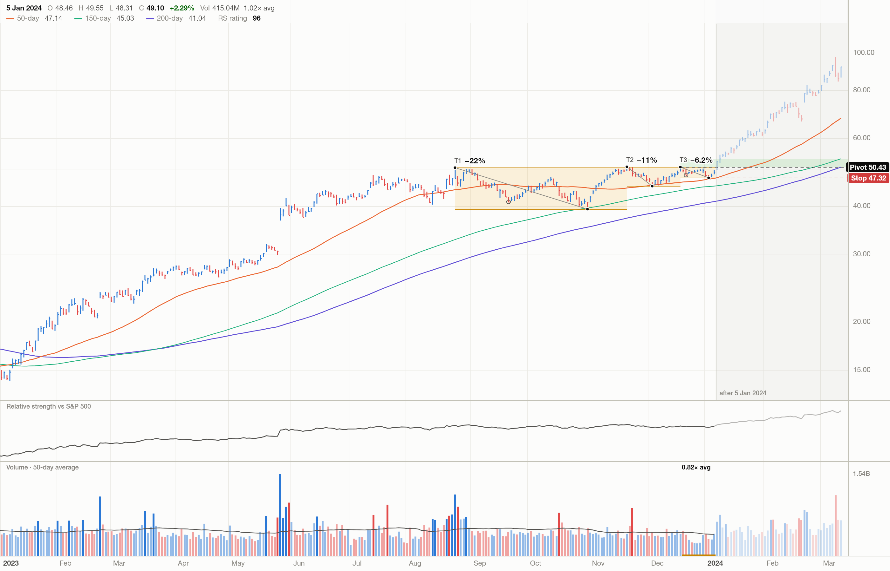

# VCP

A scanner for Mark Minervini's Volatility Contraction Pattern on US and Indian stocks. It reads each chart the way a chartist does, marks the contractions, pivot and stop on the chart, and replays the same reading over history without looking ahead.



*NVIDIA as read on 5 January 2024, the session before it broke out. Bars to the right of the line are what followed; the detector never saw them.*

## Run it

Requires Node 22 or later.

```bash
npm install
npm run universe            # build the US and India symbol lists
npm run fetch               # download daily bars (about 5 minutes, 600 MB)
npm run scan                # read every chart as of the latest session
npm run backtest            # replay the detector over history
npm run dev                 # open http://127.0.0.1:5173
```

Each command takes `--market us`, `--market in` or both by default.

| Command | What it does |
| --- | --- |
| `npm run universe` | US: every NASDAQ/NYSE/AMEX common stock above $5 with at least $5M median daily traded value. India: Nifty Total Market (750). |
| `npm run fetch -- --since 2000-01-01` | Split-adjusted daily bars from Yahoo Finance, plus the benchmark (S&P 500, Nifty 500). |
| `npm run scan -- --asof 2024-01-05` | Reads every chart on a date and writes `data/scan/<market>.json`. |
| `npm run backtest -- --from 2010-01-01` | Walk-forward replay; writes `data/backtest/<market>.json`. |
| `npm run inspect -- --market us --symbol NVDA --date 2024-01-05` | Prints one reading with every check. |
| `npm run why -- --market us --symbol NVDA --from 2023-12-20 --to 2024-01-08` | Day-by-day trace of the reading and what blocked it. |
| `npm run render -- --market us --symbol NVDA --date 2024-01-05 --future 45` | Renders the chart to PNG with the same drawing code as the app. |
| `npm test` | Published setups, rejected charts, no-lookahead and structural invariants. |

## How a chart is read

Everything is computed from bars up to the as-of date. The code is `engine/vcp.ts`; every threshold is in `engine/config.ts` with its source.

**1. Is the stock in a Stage 2 uptrend?** Minervini's Trend Template: price above the 50-, 150- and 200-day averages; 50 above 150 above 200; the 200-day rising; at least 30% above the 52-week low and within 25% of the high; relative-strength rating 70 or better. Two readings of its spirit are made explicit: the 200-day must be above its level of five months ago (the book asks for one month and prefers four to five), and the 50-day must not be falling.

**2. Where does the base start?** At the earliest swing high in the past 65 weeks that later prices have not left behind and that can be a base at all: preceded by an advance of 30% or more, no deeper than 50%. The contraction rules are then applied to that whole consolidation. A later high is never substituted because the full base failed them.

**3. What are the contractions?** The first is the fall from that high to the lowest low of the base. Each one after it is the largest high-to-low pullback in what remains after the previous contraction's low. Three things are not counted, because a chart reader does not count them:

- a pullback on the way back up that is smaller than the one that follows it (part of the recovery);
- a pullback that starts in the lower half of the base, or before price has won back half of the previous contraction (the low being retested);
- a pullback whose high price later cleared by more than 5% (a pause on the way up, not a contraction under the pivot's resistance).

Counting stops when the largest remaining pullback is no bigger than 1.4 times the stock's median daily range.

**4. Is it a VCP?** All of these must hold:

| Check | Rule |
| --- | --- |
| Base | 3 to 65 weeks long, 7.5% to 50% deep, after an advance of 30% or more |
| Count | At least two contractions |
| Each step | From 20% depth up, a contraction is at most 0.7 of the one before; the demand eases as swings shrink and ends once they are inside pivot tightness |
| Overall | Last contraction no more than 0.6 of the deepest |
| Pivot tightness | Last contraction 10% or less, since the stop sits under it |
| Pivot age | At least four sessions since its high; a newer dip younger than that does not displace it |
| Pivot position | In the upper third of the base |
| Within reach | Close within 7% of the pivot |
| Settled | The last three sessions' range no more than 1.3 times the base's typical range |
| Volume | Average volume through the final contraction below the 50-day average |
| Free trading | Daily range above 0.5%, to exclude takeover targets pinned to a bid |

**5. How good is it?** A valid setup is **grade A** when it also has three or more contractions, a 200-day average up at least 8% over five months, a base no deeper than 35%, a final contraction of 8.5% or less, and volume through it at 0.85 of average or less. Anything else valid is **grade B**, shown with what it lacks.

The pivot is the high of the final contraction and the stop is its low. The footprint is Minervini's shorthand: `18W 22/6 3T` is an 18-week base, 22% at its deepest, 6% at the pivot, three contractions.

A score from 0 to 100 orders setups within a grade (pivot tightness, how cleanly the contractions step down, volume and bar-range dry-up, relative strength, depth, pivot position). It decides neither validity nor grade.

## What it was checked against

**Published setups.** The detector reproduces these, and the tests keep it that way:

| Setup | Published or widely cited | Detector |
| --- | --- | --- |
| MercadoLibre, Dec 2007 | `6W 32/6 3T` (Minervini) | `5W 32/7 3T` the day before the breakout; third contraction measures 6.6% |
| Netflix, Oct 2009 | three contractions, 27 weeks | `26W 28/8 3T` |
| TASER, Jan 2004 | | `4W 16/7 3T` |
| Lululemon, Nov 2010 | | `20W 33/5 3T` |
| NVIDIA, Jan 2024 | | `18W 22/6 3T` |

**Blind chart readers.** There is no ground truth for a discretionary pattern, so the detector was audited against independent readers. Unmarked charts (detector-valid setups, near-misses, uptrends with no setup, downtrends, and the published cases, shuffled under anonymous names) were each judged by three readers with different stances: a textbook purist, a practising trader and a skeptic. They saw price, averages, relative strength and volume, and nothing from the detector. `npm run panel` builds such a set and `npm run panel-report` scores it against the detector.

Four rounds, 289 charts, 867 readings:

| Detector says | Charts | Readers accepted | In the final round only |
| --- | --- | --- | --- |
| Grade A | 74 | 69 (93%) | 28 of 33 (85%) |
| Grade B | 79 | 55 (70%) | 10 of 19 (53%) |
| Not a VCP | 136 | 30 (22%) | 7 of 20 (35%) |

"Accepted" means a mean verdict of borderline or better, which is where these readers put Minervini's own MercadoLibre example. The first three rounds were also used to find and fix defects in the detector, so only the final round is a clean test: read the right-hand column.

For scale, the readers agree with each other on accept-or-reject 85% to 92% of the time. The detector agrees with any one of them 75% to 79% of the time. It is not as good as a careful human eye, and the gap is about ten points.

What the readers taught the detector, in the order they found it:

- A pivot at the bottom of the base is a bounce, not a pivot.
- Months of equal swings do not become a VCP by starting the base at the last one.
- A retest of the low, or a pause that price later left behind, is not a contraction.
- Deep swings must clearly shrink; small ones near pivot tightness may sit side by side.
- A 5% dip in a steady advance is not a base.
- Zero-volume placeholder rows in the vendor data fake a volume dry-up (they are now removed).

What they still reject among grade A: a short flag after a stock has already run past its base, bars that stay wide inside a nominally tight pivot, and a final contraction that is still falling on the day.

Of 50 uptrends without a setup and downtrends shown as controls, the readers rejected 49 and the detector all 50.

`npm run panel-grade`, `npm run panel-agreement` and `npm run panel-eval` reproduce these tables from the saved verdicts; `panel-eval` also shows what each rule is worth by switching it off.

## Backtest

`npm run backtest` walks every stock forward one bar at a time. On each bar the detector reads only earlier bars; if that reading is a valid setup that has not broken out, a buy-stop rests at its pivot. Each breakout is recorded with:

- forward returns after 5, 10, 20 and 60 sessions, and the benchmark's over the same sessions;
- best and worst excursion over 60 sessions;
- one reference trade: entry at the pivot (or the open on a gap), stop at the final contraction's low capped at 10%, exit on the stop or the first close under the 50-day average.

There is one trade plan on purpose. It exists to make signals comparable, not to be tuned.

One result worth knowing before relying on the grade: in this backtest grade-A breakouts did not do better than grade-B ones. The grade measures how textbook a setup looks, which is what the readers judged. It is not a forecast.

Read the results with these in mind:

- **Survivorship.** The universe is today's listings. Stocks that were delisted or acquired are missing, which flatters every figure and also inflates the relative-strength ratings of the survivors.
- **Fills.** Assumed at the pivot or at the open, with no costs or slippage and no limit on positions.
- **Data.** Yahoo daily bars, split-adjusted. A discontinuity larger than any plausible session is treated as a vendor error and history before it is cut, but smaller errors pass.
- **Relative strength** is an approximation of IBD's rating (four quarters, the latest weighted double, ranked within this universe), not the published number.

## Layout

```
engine/     the detector, indicators, relative strength and backtest; no dependencies, runs in Node and the browser
cli/        universe, fetch, scan, backtest, render, panel tooling
src/        the app: scanner list, chart, evidence panel, backtest view
tests/      regression tests and their price fixtures
```

Price data and scan output live in `data/` and are not committed.
